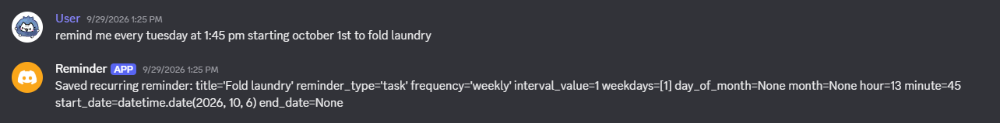
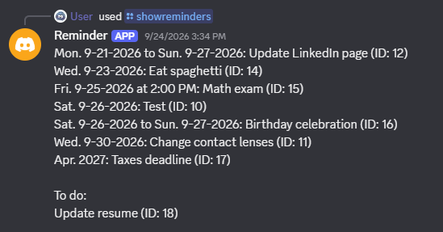
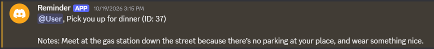
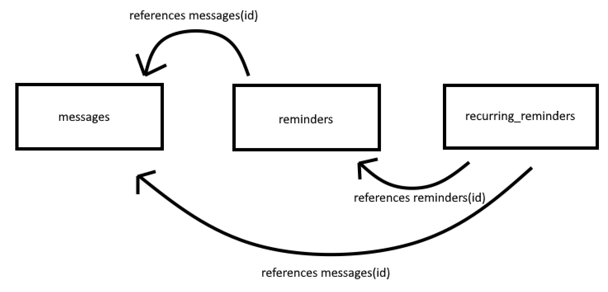

# Project Overview
Discord bot for convenient reminders. Uses OpenAI API to extract tasks, events, and important reminders from natural user conversation.  
Structured data is stored in Supabase/PostgreSQL and support retrieval through app commands.  

## Reducing token usages
When a message is sent in the channel, Reminder Bot reads it and uses regex to look for notable features like specific keywords, dates, and times.  
See  to see the keywords and more.  

## Current state
  
  

## Context window
Generates context from the conversation around the original message!  
  

## Schema
A PostgreSQL database is used to store user messages and reminders.  
- 'messages': stores source messages of reminders, including content and metadata
- 'recurring_reminders: stores reminders with intervals and other metadata. Note that a recurring_reminder generates a regular reminder.
- 'reminders': stores one time reminders and metadata

recurring_reminders references messages and reminders; reminders references messages (see below)
  

## Roadmap
- Implement natural language querying for personal reminders
- Use RAG on conversation history
- Add privacy settings
- Improve how reminders are displayed
- Containerization and deployment